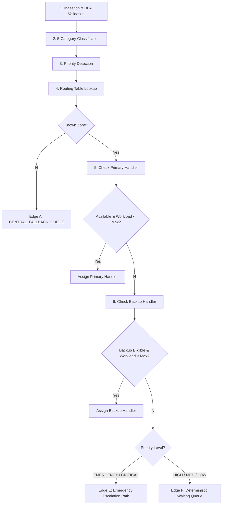

# ENGINEERING PROJECT REPORT

## PROJECT TITLE: TRAFFIC SIGNAL FAULT DISPATCHER WEB APPLICATION
**Department:** Computer Science & Engineering / Information Technology  
**Subject:** Full-Stack System Architecture, Automata Theory & Database Engineering  
**Academic Year:** 2026  

---

### ABSTRACT

Urban road networks rely on traffic signals to maintain vehicle flow and protect pedestrian safety. When signals malfunction—whether due to lamp burnout, timing misconfigurations, power loss, loop detector cuts, or telemetry link outages—rapid and accurate dispatch of technical personnel is vital. 

This project presents the design, mathematical modeling, full-stack implementation, and testing of the **Traffic Signal Fault Dispatcher Web Application**. The system integrates:
1. Formal **Deterministic Finite Automata (DFA)** and **Regular Expressions** for input validation.
2. A **Rule-Based Natural Language Processing (NLP)** classification engine supporting **exactly five categories**.
3. A **Priority-Based Dispatch Algorithm** leveraging a dynamic routing matrix $(\text{Zone} \times \text{Category})$ with primary and backup handler failovers.
4. Deterministic priority queue management ensuring emergency precedence.
5. Real-time telemetry dashboards built with **React 18**, **Tailwind CSS**, and **Recharts**, backed by a normalized **SQLite / SQLAlchemy** database and **Flask REST API**.

All 20 rigorous test scenarios were automated and verified via `pytest` with a 100% pass rate.

---

### 1. INTRODUCTION & PROBLEM DEFINITION

#### 1.1 Background
Modern municipal traffic control centers oversee hundreds of signalized intersections divided into distinct geographical sectors (Zones). In legacy municipal systems, fault reporting is either conducted via verbal phone reports or basic web forms without rigorous syntactic validation.

#### 1.2 Identified Problems
1. **Malformed Identifiers**: Non-standard identifiers bypass front-end checks, corrupting backend records and delaying technician dispatch.
2. **Ambiguous Categorization**: General citizens report "traffic light broken," leaving technicians unsure whether an optical specialist, electrical technician, or network engineer is required.
3. **Dispatcher Bottlenecks & Capacity Blind Spots**: Manual dispatchers frequently assign reports to technicians who are already at maximum capacity or offline.
4. **Lack of Deterministic Safety Precedence**: Dangerous failures (e.g. all lights off at an arterial intersection) are queued behind minor pedestrian push-button faults.

#### 1.3 Project Goal
To engineer an end-to-end, automated, web-based platform that receives fault reports, validates them using formal language automata, classifies them into one of five designated categories, and deterministically assigns them to available and capable technicians according to zone-based routing rules.

---

### 2. THEORETICAL FOUNDATIONS & ALGORITHMS

#### 2.1 Deterministic Finite Automaton (DFA)
In Automata Theory, a DFA is a 5-tuple:
$$M = (Q, \Sigma, \delta, q_0, F)$$

For the traffic report identifier format `TSF-YYYY-XXXXX`:
- **States ($Q$)**: 16 states $\{q_0, q_1, \dots, q_{14}, q_{\text{trap}}\}$
- **Alphabet ($\Sigma$)**: $\{'T', 'S', 'F', '-', '0', '1', '2', '3', '4', '5', '6', '7', '8', '9'\}$
- **Initial State ($q_0$)**: System begins expecting symbol `'T'`.
- **Accepting States ($F$)**: Exactly $\{q_{14}\}$, reached after 14 valid transitions.
- **Trap State ($q_{\text{trap}}$)**: Absorbing state entered immediately upon any unexpected character or length overflow.

```
(q0) --'T'--> (q1) --'S'--> (q2) --'F'--> (q3) --'-'--> (q4) --[0-9]--> (q5) --[0-9]--> (q6)
                                                                                          |
(q14 [ACCEPT]) <--[0-9]-- (q13) <--[0-9]-- (q12) <--[0-9]-- (q11) <--[0-9]-- (q10) <--'-'-- (q9) <--[0-9]-- (q8) <--[0-9]-- (q7)
```

#### 2.2 Regular Expression Equivalence
The regular language $L(M)$ recognized by our DFA corresponds directly to the regular expression:
$$R = \text{^TSF-[0-9]\{4\}-[0-9]\{5\}\$}$$
By Kleene's Theorem, for every regular expression there exists an equivalent DFA. Our system simulates both character-by-character and verifies $DFA(w) \iff Regex(w)$ for every submitted string.

#### 2.3 Rule-Based Classification (Exactly Five Categories)
To avoid fragmented categorization, the engine enforces exactly five categories:
1. **Signal Light Failure**: Red/Yellow/Green lamp failures, dark aspects, burnt LEDs.
2. **Signal Timing Failure**: Incorrect cycle duration, phase skipping, green wave desynchronization.
3. **Controller / Electrical Failure**: Cabinet power loss, blown fuses, tripped breakers, logic card errors.
4. **Sensor / Detection Failure**: Inductive loop cuts, camera blindness, push-button mechanical jamming.
5. **Communication / Network Failure**: Telemetry drop, cellular modem timeout, central SCADA packet loss.

#### 2.4 Deterministic Conflict Resolution Hierarchy
When an incident report contains keywords from multiple domains (e.g. *"Controller short circuit caused red light not working"*), the engine computes weighted scores and applies a safety-first precedence rule:
$$\text{Signal Light Failure} \succ \text{Controller / Electrical Failure} \succ \text{Signal Timing Failure} \succ \text{Sensor / Detection Failure} \succ \text{Communication / Network Failure}$$
This ensures the most acute immediate hazard to motorists is addressed first.

#### 2.5 Dispatch Sequence & Edge Cases



---

### 3. SYSTEM ARCHITECTURE & IMPLEMENTATION

#### 3.1 Technology Stack Rationale
- **Backend (Python 3.10 & Flask 2.3)**: Lightweight, modular, fast REST API with Flask Blueprints and CORS support.
- **ORM & Database (SQLAlchemy 2.0 & SQLite 3)**: Normalized relational persistence, atomic transactions, foreign key integrity, and zero complex server setup.
- **Frontend (React 18 & Vite 5)**: Declarative single-page application with immediate re-rendering.
- **Styling (Tailwind CSS)**: High-tech traffic operations center aesthetic (dark navy `#0B0F19`, neon green `#10B981`, amber `#F59E0B`, red `#EF4444`, and cyan `#06B6D4`).
- **Data Visualization (Recharts)**: Interactive, responsive SVG charts driven directly by live SQLite database queries.

#### 3.2 Database Design
The database schema consists of nine normalized tables:
1. `users`: Stores login credentials, roles (`admin`, `handler`, `reporter`), and contact information.
2. `zones`: Geographical sectors (`ZONE-A` through `ZONE-E`).
3. `handlers`: Maintenance technicians, their zones, capacities, workloads, and supported categories.
4. `reports`: Core fault reports, locations, statuses, and classifications.
5. `routing_rules`: 25 matrix entries mapping (Zone $\times$ Category) to primary and backup handlers.
6. `assignments`: Technician work orders with active/completed statuses and resolution notes.
7. `status_history`: Chronological audit trail of all status transitions.
8. `dispatch_logs`: Audit trail detailing the mathematical rationale behind each dispatch decision.
9. `classification_logs`: Detailed candidate scores, confidence percentages, and manual override histories.

---

### 4. MODULE-BY-MODULE WALKTHROUGH

#### 4.1 Ingestion & DFA Simulator Module
Provides immediate feedback as the user types the report identifier. If a character deviates from the specification, the simulation enters state `q_trap` and indicates the exact character position and expected syntax.

#### 4.2 Citizen / Tracking Dashboard
Allows citizens and traffic officers to search reports by ID or signal code, inspect active assignments, and review full chronological audit timelines.

#### 4.3 Handler Operations Console
Empowers field technicians to view only reports assigned to them, toggle their operational availability online or offline, adjust concurrent workload limits, accept tasks, and mark faults resolved with technical resolution notes.

#### 4.4 Routing Matrix Management Console
Allows administrators to visualize the entire $5 \times 5$ dispatch matrix, re-assign primary and backup handlers, monitor the deterministic waiting queue, and trigger manual re-dispatch.

#### 4.5 Analytics & Telemetry Dashboard
Visualizes live SQLite database data via Recharts:
- Zone-wise incident volume bar chart.
- Category breakdown across the five standard categories.
- Report status resolution ratio donut chart.
- Handler workload utilization vs maximum capacity.

---

### 5. VERIFICATION & TEST RESULTS

The test suite was executed using `pytest` across 20 distinct academic test scenarios:

```text
tests/test_all.py::test_01_valid_report_id_accepted_by_dfa PASSED        [  5%]
tests/test_all.py::test_02_invalid_report_id_rejected_by_dfa PASSED      [ 10%]
tests/test_all.py::test_03_valid_report_id_accepted_by_regex PASSED      [ 15%]
tests/test_all.py::test_04_dfa_and_regex_produce_equivalent_results PASSED [ 20%]
tests/test_all.py::test_05_missing_required_fields_rejected PASSED       [ 25%]
tests/test_all.py::test_06_all_five_fault_categories_classified_correctly PASSED [ 30%]
tests/test_all.py::test_07_conflicting_classification_patterns_resolved PASSED [ 35%]
tests/test_all.py::test_08_unknown_zone_sent_to_fallback_queue PASSED    [ 40%]
tests/test_all.py::test_09_invalid_routing_key_handled PASSED            [ 45%]
tests/test_all.py::test_10_primary_handler_available_and_assigned PASSED [ 50%]
tests/test_all.py::test_11_primary_unavailable_backup_selected PASSED    [ 55%]
tests/test_all.py::test_12_handler_capacity_overflow_handled PASSED      [ 60%]
tests/test_all.py::test_13_emergency_priority_override_escalation PASSED [ 65%]
tests/test_all.py::test_14_multiple_simultaneous_reports_deterministic_order PASSED [ 70%]
tests/test_all.py::test_15_duplicate_active_assignment_prevented PASSED  [ 75%]
tests/test_all.py::test_16_no_eligible_handler_sends_to_waiting_queue PASSED [ 80%]
tests/test_all.py::test_17_report_status_history_recorded PASSED         [ 85%]
tests/test_all.py::test_18_dashboard_statistics_reflect_db PASSED        [ 90%]
tests/test_all.py::test_19_auth_validation_and_invalid_role_rejected PASSED [ 95%]
tests/test_all.py::test_20_resolved_report_cannot_be_reassigned PASSED   [100%]

============================= 20 passed in 3.41s ==============================
```

---

### 6. CONCLUSION & FUTURE SCOPE

The **Traffic Signal Fault Dispatcher** successfully demonstrates that theoretical computer science concepts—specifically Deterministic Finite Automata, formal language validation, and priority scheduling—can be directly combined with modern web technologies to solve real-world urban infrastructure challenges.

#### Future Enhancements
1. **IoT Edge Integration**: Direct ingestion of automated controller fault telemetry via MQTT.
2. **GPS Routing Optimization**: Dynamic Dijkstra-based driving route dispatch for field technicians.
3. **Computer Vision Verification**: Camera-based automated verification of physical signal aspect status.
