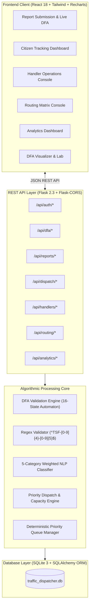
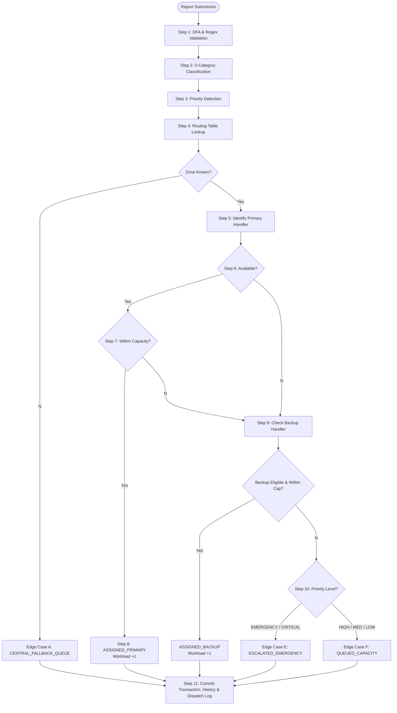

# Traffic Signal Fault Dispatcher Web Application

[](https://www.python.org/)
[](https://flask.palletsprojects.com/)
[](https://react.dev/)
[](https://www.sqlite.org/)
[](https://pytest.org/)

An academic-grade, full-stack municipal traffic engineering platform designed to receive real-time traffic signal fault telemetry, validate identifiers character-by-character via a formal **Deterministic Finite Automaton (DFA)** and **Regular Expressions**, categorize faults into **exactly five categories** via weighted keyword NLP, and intelligently route incidents to zone-based maintenance handlers under dynamic availability and capacity constraints.

---

## 1. Project Introduction & Problem Statement

Urban traffic signal failures (such as conflicting greens, blacked-out intersections, or severed inductive detector loops) introduce grave public safety risks and acute congestion. Traditional municipal fault reporting systems suffer from:
1. **Unstructured Data & Malformed Identifiers**: Lack of strict syntax checking allows garbage IDs to flood dispatch queues.
2. **Ambiguous Triage**: Faults are vaguely labeled, delaying technical specialization dispatch.
3. **Dispatcher Bottlenecks**: Manual routing overlooks technician overload, zone boundaries, and backup handler availability.
4. **No Deterministic Safety Precedence**: High-risk collisions are queued on a basic first-in-first-out basis without emergency priority override.

The **Traffic Signal Fault Dispatcher** solves this by establishing a rigorous automated pipeline:
$$\text{SUBMISSION} \to \text{DFA VALIDATION} \to \text{REGEX EQUIVALENCE} \to \text{CLASSIFICATION} \to \text{PRIORITY DETECTION} \to \text{ROUTING LOOKUP} \to \text{CAPACITY CHECK} \to \text{DISPATCH / BACKUP / ESCALATE} \to \text{ANALYTICS}$$

---

## 2. Key Objectives & Features

- **Formal DFA & Regex Engine**: Validates standard municipal identifiers (`TSF-YYYY-XXXXX`) using a 16-state automaton $M = (Q, \Sigma, \delta, q_0, F)$ running in lockstep with Regex `^TSF-[0-9]{4}-[0-9]{5}$`.
- **Exact Five-Category Fault Classifier**:
  1. *Signal Light Failure*
  2. *Signal Timing Failure*
  3. *Controller / Electrical Failure*
  4. *Sensor / Detection Failure*
  5. *Communication / Network Failure*
- **Deterministic Conflict Resolution**: Prioritizes public safety (`Signal Light Failure` $\succ$ `Controller Failure` $\succ$ `Timing Failure` $\succ$ `Sensor Failure` $\succ$ `Communication Failure`) when descriptions match multiple domains, recording audit confidence scores.
- **Dynamic Routing & Capacity Management**: 25-cell routing matrix mapping $(\text{Zone} \times \text{Category}) \to (\text{Primary Handler}, \text{Backup Handler}, \text{Escalation Path})$.
- **Edge Cases Handled (A-G)**:
  - *Edge Case A (Unknown Zone)*: Central Fallback Queue routing.
  - *Edge Case B (Malformed ID)*: Rejection prior to dispatch with exact trap state reason.
  - *Edge Case C (Primary Unavailable)*: Automatic selection of backup handler.
  - *Edge Case D (Capacity Overflow)*: Secondary failover or waiting queue.
  - *Edge Case E (Emergency Priority Override)*: Emergency bypass directly to rapid escalation units.
  - *Edge Case F (Simultaneous Reports)*: Deterministic priority queue ranking ($\text{EMERGENCY} \succ \text{CRITICAL} \succ \text{HIGH} \succ \text{MEDIUM} \succ \text{LOW}$, with earliest submission tie-break).
  - *Edge Case G (Duplicate Assignment Prevention)*: Strict database constraints preventing double-booking active handlers.
- **Comprehensive Dashboards**:
  1. Citizen / Reporter Submission with live DFA simulation feedback.
  2. User Tracking Dashboard with full lifecycle status audit timelines.
  3. Handler Operations Console with online/offline toggling, capacity stepper, and resolution notes.
  4. Routing Matrix Management Console with live waiting queue re-dispatch.
  5. Analytics Dashboard powered by Recharts with database-driven telemetry.
  6. DFA State Machine Visualizer showcasing step-by-step state transitions.

---

## 3. Technology Stack

| Layer | Technologies |
| :--- | :--- |
| **Frontend** | React 18, Vite 5, Tailwind CSS, Recharts 2, Lucide React Icons |
| **Backend** | Python 3.10+, Flask 2.3, Flask-CORS, Werkzeug (Security) |
| **Database** | SQLite 3, SQLAlchemy 2.0 ORM |
| **Algorithms** | Deterministic Finite Automaton (DFA), Regular Expressions, Weighted Pattern NLP, Deterministic Priority Queues |
| **Testing** | Pytest 9.2 (20 automated test scenarios) |

---

## 4. System Architecture



---

## 5. Formal DFA & Regex Implementation

### 5.1 Formal 5-Tuple Definition
$$M = (Q, \Sigma, \delta, q_0, F)$$
- **State Set** $Q = \{q_0, q_1, q_2, q_3, q_4, q_5, q_6, q_7, q_8, q_9, q_{10}, q_{11}, q_{12}, q_{13}, q_{14}, q_{\text{trap}}\}$
- **Alphabet** $\Sigma = \{'T', 'S', 'F', '-', '0'..'9'\}$
- **Initial State** $q_0$
- **Accepting States** $F = \{q_{14}\}$
- **Trap / Rejection State** $q_{\text{trap}}$

### 5.2 Transition Table $\delta(q, c)$

| State $q$ | Input Symbol $c$ | Next State $\delta(q, c)$ | State Meaning & Verification |
| :--- | :--- | :--- | :--- |
| **$q_0$** | `'T'` | **$q_1$** | Starts with prefix `'T'` |
| **$q_1$** | `'S'` | **$q_2$** | Second character `'S'` |
| **$q_2$** | `'F'` | **$q_3$** | Third character `'F'` |
| **$q_3$** | `'-'` | **$q_4$** | Delimiter 1 |
| **$q_4$** | `d ∈ [0-9]` | **$q_5$** | Year Digit 1 |
| **$q_5$** | `d ∈ [0-9]` | **$q_6$** | Year Digit 2 |
| **$q_6$** | `d ∈ [0-9]` | **$q_7$** | Year Digit 3 |
| **$q_7$** | `d ∈ [0-9]` | **$q_8$** | Year Digit 4 (4-digit Year) |
| **$q_8$** | `'-'` | **$q_9$** | Delimiter 2 |
| **$q_9$** | `d ∈ [0-9]` | **$q_{10}$** | Sequence Digit 1 |
| **$q_{10}$** | `d ∈ [0-9]` | **$q_{11}$** | Sequence Digit 2 |
| **$q_{11}$** | `d ∈ [0-9]` | **$q_{12}$** | Sequence Digit 3 |
| **$q_{12}$** | `d ∈ [0-9]` | **$q_{13}$** | Sequence Digit 4 |
| **$q_{13}$** | `d ∈ [0-9]` | **$q_{14}$** | Sequence Digit 5 (**ACCEPTED**) |
| **$q_{14}$** | Any | **$q_{\text{trap}}$** | String length overflow ($>14$ characters) |
| **Any State** | Unexpected $c$ | **$q_{\text{trap}}$** | Malformed format rejection |

### 5.3 Equivalent Regular Expression
```regex
^TSF-[0-9]{4}-[0-9]{5}$
```
Both the DFA and Regex are tested in unit tests and live in the UI for complete parity.

---

## 6. Exact Five Fault Categories & Conflict Resolution

The system strictly supports **exactly five fault categories**:
1. **Signal Light Failure**: Red/Yellow/Green lamp burnt out, broken optical head, completely dark signal.
2. **Signal Timing Failure**: Incorrect cycle duration, timer drift, rapid erratic switching, green wave sync loss.
3. **Controller / Electrical Failure**: Controller unit rebooting, power supply failure, circuit breaker tripped.
4. **Sensor / Detection Failure**: Inductive vehicle loop severed, CCTV detection camera offline, push button stuck.
5. **Communication / Network Failure**: Telemetry link lost, cellular modem timeout, central SCADA packet loss.

### Deterministic Conflict Priority Hierarchy
If a description matches multiple categories, scores are tallied by rule weights. In the event of a tie or composite incident, the safety hierarchy dictates:
$$\text{Signal Light Failure} \succ \text{Controller / Electrical Failure} \succ \text{Signal Timing Failure} \succ \text{Sensor / Detection Failure} \succ \text{Communication / Network Failure}$$
All matching categories are logged into `classification_logs` for auditability. Administrators can manually correct a category, preserving the original classification in audit history.

---

## 7. Dispatch Algorithm & Special Edge Cases



---

## 8. Automated Test Suite (20 Test Scenarios)

The test suite is automated via `pytest` in `backend/tests/test_all.py`:

| Test ID | Test Scenario / Objective | Input Data | Expected Result | Actual Result | Status |
| :---: | :--- | :--- | :--- | :--- | :---: |
| **TC-01** | Valid report identifier accepted by DFA | `TSF-2026-00001` | Terminal state $q_{14}$, accepted=True | Terminal state $q_{14}$, accepted=True | **PASS** |
| **TC-02** | Invalid report identifier rejected by DFA | `TXF-2026-00001` | Trap state $q_{\text{trap}}$, descriptive error | Trap state $q_{\text{trap}}$, descriptive error | **PASS** |
| **TC-03** | Valid report identifier accepted by regex | `TSF-2026-99999` | Regex match == True | Regex match == True | **PASS** |
| **TC-04** | DFA and regex produce equivalent results | Valid & malformed test battery | Equivalence == 100% | Equivalence == 100% | **PASS** |
| **TC-05** | Missing required fields rejected | Missing name, signal_id, location | Validation fails, error dict returned | Validation fails, error dict returned | **PASS** |
| **TC-06** | All five fault categories classified correctly | 5 targeted descriptions | Correct category for all 5 | Correct category for all 5 | **PASS** |
| **TC-07** | Conflicting classification patterns resolved | Composite multi-domain text | Primary safety category resolved | Primary safety category resolved | **PASS** |
| **TC-08** | Unknown zone sent to fallback queue | `ZONE-UNKNOWN-99` | Status `PENDING`, log `FALLBACK_UNKNOWN_ZONE` | Status `PENDING`, log `FALLBACK_UNKNOWN_ZONE` | **PASS** |
| **TC-09** | Invalid routing key handled correctly | Zone exists, unmapped category | Status `PENDING`, log `NO_ROUTING_RULE` | Status `PENDING`, log `NO_ROUTING_RULE` | **PASS** |
| **TC-10** | Primary handler available and within capacity | Eligible primary technician | `ASSIGNED_PRIMARY`, workload increments | `ASSIGNED_PRIMARY`, workload increments | **PASS** |
| **TC-11** | Primary unavailable and backup selected | Primary marked unavailable | `ASSIGNED_BACKUP`, backup workload +1 | `ASSIGNED_BACKUP`, backup workload +1 | **PASS** |
| **TC-12** | Handler capacity overflow handled correctly | Primary at max capacity ($2/2$) | `ASSIGNED_BACKUP`, fails over to backup | `ASSIGNED_BACKUP`, fails over to backup | **PASS** |
| **TC-13** | Emergency priority override escalation | Handlers full + EMERGENCY priority | Status `ESCALATED`, log `ESCALATED_EMERGENCY` | Status `ESCALATED`, log `ESCALATED_EMERGENCY` | **PASS** |
| **TC-14** | Simultaneous reports ordered deterministically | 5 reports of varying priorities | Order: Emergency $\to$ Crit $\to$ High $\to$ Med $\to$ Low | Order: Emergency $\to$ Crit $\to$ High $\to$ Med $\to$ Low | **PASS** |
| **TC-15** | Duplicate active assignment prevented | Re-dispatch on report with active tech | Rejected: `DUPLICATE_ACTIVE_ASSIGNMENT_PREVENTED` | Rejected: `DUPLICATE_ACTIVE_ASSIGNMENT_PREVENTED` | **PASS** |
| **TC-16** | Normal priority full capacity queued | Handlers full + MEDIUM priority | Status `PENDING`, log `QUEUED_CAPACITY` | Status `PENDING`, log `QUEUED_CAPACITY` | **PASS** |
| **TC-17** | Report status history recorded correctly | Status transition lifecycle | Complete audit history entries created | Complete audit history entries created | **PASS** |
| **TC-18** | Dashboard statistics reflect database | DB query vs analytics endpoint | Exact metric match from SQLite | Exact metric match from SQLite | **PASS** |
| **TC-19** | Invalid user permissions & auth rejected | Illegal role / bad password | Status 400 Bad Request / 401 Unauthorized | Status 400 Bad Request / 401 Unauthorized | **PASS** |
| **TC-20** | Resolved report cannot be reassigned | Re-dispatch on `RESOLVED` report | Rejected: `ALREADY_RESOLVED` | Rejected: `ALREADY_RESOLVED` | **PASS** |

---

## 9. Installation & Run Instructions

### 9.1 Prerequisites
- Python 3.10 or higher
- Node.js 18 or higher (with npm)

### 9.2 Clone & Workspace Setup
```bash
cd traffic-fault-dispatcher
```

### 9.3 Backend Setup & Database Seeding
```bash
# 1. Install Python dependencies
pip install -r backend/requirements.txt

# 2. Initialize and Seed the SQLite Database
python database/seed_data.py

# 3. Run Automated Pytest Suite
cd backend
pytest -v tests/test_all.py
cd ..

# 4. Start the Flask API Backend Server (runs on http://localhost:5000)
cd backend
python run.py
```

### 9.4 Frontend Setup & Launch
```bash
# 1. Navigate to frontend directory
cd frontend

# 2. Install dependencies (if not already installed)
npm install

# 3. Start the Vite React Development Server (runs on http://localhost:5173)
npm run dev
```

Open your browser at: **`http://localhost:5173`**

---

## 10. Demo User Credentials

The database comes pre-seeded with accounts for all operational roles:

| Role | Username | Password | Full Name & Title | Capabilities |
| :--- | :--- | :--- | :--- | :--- |
| **Administrator** | `admin` | `AdminPassword123!` | System Administrator | Full access: Routing rules matrix, zones, escalation override, dispatch logs |
| **Technician / Handler** | `handler1` | `HandlerPassword123!` | Alex Carter (Signal Tech) | Operations console, toggle availability, adjust capacity, accept & resolve tasks |
| **Technician / Handler** | `handler2` | `HandlerPassword123!` | Priya Sharma (Electrical Lead) | Electrical controller specialist |
| **Technician / Handler** | `handler3` | `HandlerPassword123!` | David Kim (Sensor Tech) | Inductive loop and detection sensor specialist |
| **Technician / Handler** | `handler4` | `HandlerPassword123!` | Elena Rostova (Network Tech) | Telemetry and SCADA network specialist |
| **Reporter** | `reporter` | `ReporterPassword123!` | Officer Johnathan Reed | Public fault submission, DFA verification, incident tracking |

---

## 11. REST API Documentation Summary

| Method | Endpoint | Description |
| :--- | :--- | :--- |
| `GET` | `/api/health` | Health check probe |
| `POST` | `/api/auth/login` | User authentication |
| `POST` | `/api/dfa/simulate` | Simulates character-by-character DFA validation on input ID |
| `GET` | `/api/dfa/generate-id` | Generates next unique valid sequential `TSF-YYYY-XXXXX` identifier |
| `POST` | `/api/reports/submit` | Validates, classifies, saves, and executes immediate dispatch |
| `POST` | `/api/reports/preview-classification` | Real-time classification scores as user types fault description |
| `GET` | `/api/reports` | List reports with filtering (status, zone, category, priority, search) |
| `GET` | `/api/reports/<id_or_code>` | Get single report with active assignment, history, and dispatch logs |
| `PUT` | `/api/reports/<id_or_code>` | Update report / Admin manual category override with audit history |
| `GET` | `/api/handlers` | List handlers with workload, capacity, availability, supported categories |
| `PUT` | `/api/handlers/<id>/availability` | Toggle online/offline technician availability |
| `PUT` | `/api/handlers/<id>/capacity` | Modify technician max concurrent capacity |
| `POST` | `/api/handlers/assignments/<id>/status` | Update task status (`IN_PROGRESS` or `RESOLVED` with notes) |
| `GET` | `/api/routing/rules` | Fetch 25-cell routing table rules |
| `PUT` | `/api/routing/rules/<id>` | Update primary handler, backup handler, or escalation path |
| `GET` | `/api/dispatch/waiting-queue` | Get deterministic priority-ordered waiting queue |
| `POST` | `/api/dispatch/dispatch-report/<id>` | Manually trigger dispatch engine on a pending report |
| `GET` | `/api/analytics/dashboard` | Summary cards: total, resolved, pending, active, utilization rate |
| `GET` | `/api/analytics/zone-distribution` | Zone-wise fault distribution (Active vs Resolved) |
| `GET` | `/api/analytics/category-distribution`| Breakdown across exact 5 fault categories |
| `GET` | `/api/analytics/handler-workload` | Technicians workload vs capacity telemetry |

---

## 12. Troubleshooting

1. **Port 5000 Already in Use**:
   If port 5000 is occupied, set `PORT=5001` in your environment or launch backend with `python run.py --port 5001`.
2. **CORS Errors**:
   The backend includes `Flask-CORS` configured with `origins: "*"` and credentials support.
3. **Database Reset**:
   To reset the database to a pristine seed state, simply delete `database/traffic_dispatcher.db` and run `python database/seed_data.py`.
